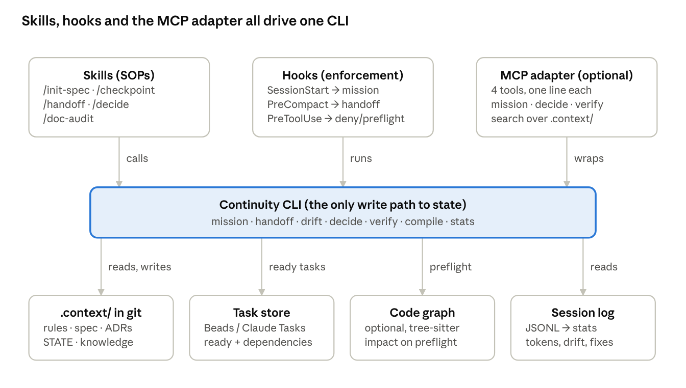

# Architecture

baton is a CLI-first continuity layer. Skills, hooks and an optional MCP adapter are three entry points into one CLI, and the CLI is the only thing that writes continuity state. Background and evidence: [research report](../research/2026-10-15-research-report.md).



## Principles

1. **Files in git are the truth.** `.context/` is committed, human-readable and diffable. No server owns state.
2. **Structured where mutable, prose where stable.** Tasks, state and decisions are structured; the spec is prose.
3. **Every section carries provenance:** `verified_at` (commit SHA) and `source_paths`. Stale sections are flagged or withheld.
4. **Smallest fresh brief.** Only the mission packet loads by default; everything else is retrieved on demand.
5. **Hooks enforce, skills guide, MCP adapts.** Deterministic gates live in hooks; procedures live in skills; the MCP only exposes queries.
6. **Measured.** Every claim about tokens, drift or corrections comes from the session log.
7. **Fail open, loudly.** A broken hook prints to stderr and exits 0. Only an explicit deny changes agent behaviour.

## Source layout

```
src/
  cli.ts              entry (bundled to dist/baton.mjs)
  program.ts          commander program; registers every command
  commands/           one file per command; thin: parse options, call core, print
  core/               pure logic + small IO wrappers, unit-tested
    types.ts          Section, SectionMeta, FreshnessLevel, Task
    config.ts         .context/config.yaml schema + defaults (zod)
    frontmatter.ts    whole-file frontmatter + inline section markers
    freshness.ts      pure classifier: fresh/aging/stale/superseded/unverified
    budget.ts         greedy character-budget fit for the packet
    git.ts            git CLI wrapper (rev-list counts, diff --stat, status)
    glob.ts           tiny glob matcher for source_paths and guards
    transcript.ts     Claude Code JSONL reader, usage de-duplication
    decisions.ts      MADR naming, numbering, record rendering, status parsing (ADR 0018)
    decide.ts         decision records: create, accept, supersede, list (ADR 0018)
    preflight.ts      decisions and spec sections related to a proposed change (ADR 0018)
    verify.ts         check runner, diff rule, active task (ADR 0019)
    compile.ts        AGENTS.md and the CLAUDE.md import from rules.md (ADR 0022)
    sections.ts       section index over .context/ (ADR 0012)
    drift.ts          freshness from git history, dead references, drift log (ADR 0013)
    verify-doc.ts     verified_at stamping (ADR 0012)
    mission.ts        packet assembly (ADR 0014)
    handoff.ts        generated STATE.md (ADR 0024)
    stats.ts          session metrics and snapshots (ADR 0016)
    init.ts, templates.generated.ts  scaffolding from embedded templates (ADR 0017)
    explain/          `baton explain`: target resolution, fact collection, voice templates (ADR 0010)
    tasks/            TaskStore interface + backends
      native/         default store ported from Beads: model, ids, jsonl, db (node:sqlite), service
      beads.ts        optional adapter over an installed `bd`
      snapshot.ts     read-only task view for mission and handoff
  hooks/
    entry.ts          fast path for baton hook, skips the commander program (ADR 0024)
    io.ts             stdin parsing, per-harness output rendering
    dispatch.ts       event -> handler, fail-open wrapper
    guards.ts         protected targets, edit targets, shell-write and dependency heuristics (ADR 0025)
    pre-tool-use.ts   protected-state denies, preflight context (ADR 0025)
    post-tool-use.ts  notices for sections an edit touched (ADR 0021)
    stop.ts           opt-in check of the active task (ADR 0019)
  mcp/server.ts       four-tool MCP adapter (lazy-loaded chunk)
plugin/               Claude Code plugin: manifest, hooks.json, skills (incl. the /baton router), dist/ (built)
templates/context/    what `baton init` scaffolds into a project
.context/             baton's own continuity state (dogfooding)
```

`core/` must not import from `commands/`, `hooks/` or `mcp/`. `node:sqlite` is loaded lazily inside the task store, so hooks that do not touch tasks never pay for it. Commands, hooks and MCP tools all call into `core/`, which is how one write path is guaranteed.

## Command contract

| Command | Reads | Writes | Exit codes | Phase |
|---|---|---|---|---|
| `init [--harness] [--no-hooks] [--force]` | templates | `.context/`, `AGENTS.md`, `CLAUDE.md`, `.gitattributes`/`.gitignore` lines (Claude hooks ship in the plugin, ADR 0017) | 0, 1, 3 for codex/gemini | done |
| `mission [--budget] [--task] [--format]` | STATE, task store, spec, decisions, git | `.context/.cache/last-packet.*` | 0, 1 | done |
| `handoff [--reason] [--transcript] [--dry-run]` | task store, git status/diff, transcript tail | `.context/STATE.md` (overwrite) | 0, 1 | done |
| `drift [--format] [--fail-on]` | all sections, git | `.context/.cache/drift.jsonl` | 0, 2 on `--fail-on` hit | done |
| `verify-doc <ids...>` | sections | `verified_at` = first 12 chars of HEAD on those sections | 0, 1 | done |
| `stats [--session] [--since] [--format]` | transcripts, drift log | `.context/.cache/stats/` snapshots | 0, 1 | done |
| `decide [title] [--preflight] [--supersedes] [--status] [--accept] [--spec] [--paths] [--context] [--considered] [--outcome] [--consequence] [--deciders]` | decisions, spec and the other sections (index), git HEAD | new ADR (exclusive create); status and verified_at of the accepted record and of the record it supersedes (ADR 0018) | 0, 1, 2 when preflight finds a constraint or a status change is refused | done |
| `verify <task> [--no-diff]` | the task's check: labels, git log --since, git status | closes the task in the store (ADR 0019) | 0, 1, 2 on a failed check or an empty diff, 3 for non-native backends | done |
| `compile [--check] [--force]` | .context/rules.md | AGENTS.md (generated; a hand-written one only with --force), CLAUDE.md (@AGENTS.md line ensured) (ADR 0022) | 0, 1, 2 on --check drift, over 60 lines or a hand-written AGENTS.md | done |
| `task create\|list\|show\|ready\|blocked\|update\|close\|reopen\|delete\|dep\|comment\|import` | `.context/tasks.jsonl` (via cache) | `.context/tasks.jsonl` | 0, 1, 2 on refused state change (claimed, blocked, cycle, closing a checked task without --force; ADR 0019) | done |
| `remember \| recall \| forget \| memories` | `.context/memories.jsonl` | `.context/memories.jsonl` | 0, 1 | done |
| `hook <event> [--harness]` | stdin JSON | per handler; .context/.cache/guard.jsonl and touched.jsonl | 0 always; structured deny (PreToolUse) and block (Stop) | done |
| `explain <thing> [--as] [--format]` · `explain -c/-p/-s/--force` · `--delete` · `--templates` | `.context/`, `docs/`, `package.json`, git file list, templates | `.context/explain/`, `~/.baton/explain/` (create/delete only) | 0, 1, 2 on tie or refused template change | side track |
| `mcp` | — | — (delegates to core) | — | 3 |

Exit codes: `0` ok · `1` error · `2` check failed / blocked · `3` not implemented yet (`src/core/errors.ts`).

## Hook wiring

| baton event | Claude Code | Codex | Gemini CLI | Handler (phase) |
|---|---|---|---|---|
| `session-start` | SessionStart `startup\|resume\|clear\|compact` | SessionStart | SessionStart | inject `mission` output as `additionalContext` (1) |
| `pre-compact` | PreCompact | PreCompact | PreCompress | full `handoff` (1) |
| `session-end` | SessionEnd (timeout 10 s) | SessionEnd (≤ 3 s) | SessionEnd | fast deterministic `handoff` (1) |
| `pre-tool-use` | PreToolUse `Edit\|Write\|MultiEdit\|NotebookEdit\|Bash\|PowerShell` | PreToolUse `Bash\|apply_patch` | BeforeTool `write_file\|replace\|run_shell_command` | deny protected-state edits; preflight context for dependency and migration files (2, ADR 0025) |
| `post-tool-use` | PostToolUse `Edit\|Write\|MultiEdit` | PostToolUse | AfterTool | notice the sections whose source_paths an edit touched; uncommitted changes age them (2, ADR 0021) |
| `stop` | Stop (timeout 600 s; acts only with verify.onStop) | Stop | AfterAgent | run the active task's check; block the stop when it fails (2, ADR 0019) |

Claude Code wiring ships in `plugin/hooks/hooks.json` (exec form: `node ${CLAUDE_PLUGIN_ROOT}/dist/baton.mjs hook <event>`, no shell, so it works on Windows). Codex and Gemini wiring is written by `baton init --harness` in Phase 3. Facts behind this table: [implementation notes §1, §5](../research/2026-10-16-implementation-notes.md).

## Performance budget

Hooks run on every session start and every guarded tool call. Target **< 150 ms** wall time for `hook pre-tool-use` and **< 1 s** for `hook session-start` on a mid-size repo. The MCP SDK is split into a lazily loaded chunk so hooks do not parse it (scaffold-time measurement, platform not recorded: ~75 ms for a no-op hook vs ~35 ms for bare `node`). Measured on Windows 11, Node 22.16 (implementation notes §1): bare `node -e 0` 53 ms, `baton --version` through the full bundle 142 ms, and the no-op `hook pre-tool-use` 144 ms before the fast path existed; with it, `npm run smoke:hooks` measures a PreToolUse median of about 110 ms. `baton hook` therefore bypasses the commander program (ADR 0024). `hook post-tool-use` shares the < 150 ms budget. `hook stop` does nothing unless `verify.onStop` is set; then it runs the active task's check (up to 540 s, ADR 0019).

## Integrations (consume, do not replace)

- **Tasks:** baton's native store by default (ported from Beads, ADR 0009); Beads itself as an optional backend (`bd ready --json`); a Claude Code Tasks adapter is not built (format undocumented). Labels `spec:<id>` and `check:<cmd>` work on every backend.
- **Decisions:** MADR 4.0 files, adr-kit compatible.
- **Impact:** optional code-graph MCP for `decide --preflight` (Phase 2+).
- **Rules:** output compatible with rulesync-class generators.
- **Spec/plan authoring:** upstream (superpowers, Spec Kit). baton's only authoring skill is `/init-spec`. The `/baton` skill is a router, not an authoring skill: `/baton <command>` runs the CLI, and `/baton explain` writes an answer in a chosen voice from `baton explain` output.
