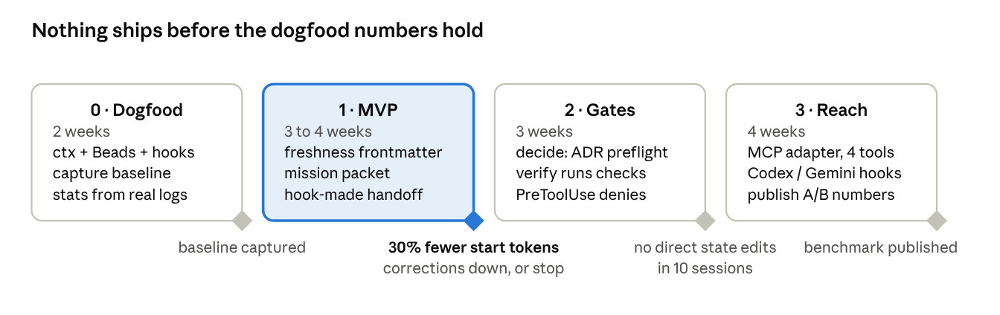

# Roadmap

Four phases, about 13 weeks, each gated on a measured result. Nothing ships before the dogfood numbers hold.

This file lists phase deliverables and gates. Day-to-day work lives in the task store, not here: `baton task ready` (the Phase 1 backlog is already in `.context/tasks.jsonl`).

## Where things stand

**Scaffold done (2026-10-16):** CLI contract with every command stubbed (exit 3), hook dispatcher wired and fail-open, Claude Code plugin + five skills, MCP adapter answering `tools/list`, pure core helpers with tests (section parsing, freshness classifier, budget fit, glob/guards, transcript usage, Beads JSON mapping, git commit counts), CI on Linux and Windows.

**Native task store done (2026-10-16):** Beads' task model ported to TypeScript (ADR 0009): `baton task` (create, list, show, ready, blocked, update/claim, close, reopen, delete, dep, comment, import) and `baton remember/recall/forget/memories`, JSONL in git with a SQLite cache, tested against Beads' golden vectors and a multi-process race. Next: Phase 0.

## Phase 0 · Dogfood (2 weeks) — gate: baseline captured

Uses existing tools only; costs nothing to build.

- [ ] `git init`, first commit, then stamp this repo's `.context/` sections (manually set `verified_at` to that SHA until `verify-doc` exists)
- [ ] Work this repo from `baton task ready`; optionally run Beads on one other project for comparison
- [ ] Install ActiveMemory ctx and a PreCompact handoff recipe on one real project, for comparison
- [ ] Snapshot transcripts weekly (they are deleted after 30 days by default)
- [ ] Record baseline: tokens at session start, corrections per session, time to resume (by hand or with ccusage until `stats` exists)
- [ ] Settle open questions 1–3 below

## Phase 1 · MVP (3–4 weeks) — gate: ≥ 30% fewer start tokens and corrections down, or stop

| Deliverable | Done when |
|---|---|
| Section index over `.context/` | Parses rules, spec, STATE, knowledge, decisions; duplicate ids across files rejected |
| `drift` + `verify-doc` | Per-section commit counts and dead refs; text and JSON output; `--fail-on` exits 2 |
| `mission --budget` | Packet ≤ `maxChars`, stale/unverified withheld and listed, factual phrasing; snapshot test on this repo |
| `handoff` | STATE.md rebuilt from task store + `git status` + `diff --stat` + last tool calls; idempotent; < 1 s |
| `stats` | Tokens at session start and doc tokens per task from real transcripts; snapshot to `.context/.cache/stats/` |
| `init` | Scaffolds from `templates/`, writes router + pointer, never overwrites without `--force` |
| Hooks | SessionStart (incl. `compact`), PreCompact, SessionEnd wired to the above; verified on Windows and Linux |
| Skills | `/init-spec`, `/checkpoint` work end to end through the CLI |
| Task store in the packet | Ready tasks + their `spec:` sections in `mission`; `handoff` reads in-progress and recently closed tasks; memories included under budget |

## Phase 2 · Gates (3 weeks) — gate: no direct state edits in 10 sessions

- `decide` with MADR records, supersede chains, spec-conflict flags, `--preflight`
- `verify` runs check commands; closes tasks only on exit 0 (+ non-empty diff by default)
- PreToolUse denies on protected state (edit tools and shell); preflight on dependency and migration files
- PostToolUse marks touched sections aging; opt-in Stop verification
- `compile` + `compile --check` in CI

## Phase 3 · Reach (4 weeks) — gate: benchmark published

- MCP adapter: four tools implemented over core
- `init --harness codex|gemini` writes their hook config; skills tested in Codex and Gemini CLI
- Publish to npm as `baton-ctx`; plugin marketplace entry
- Paired A/B benchmark and harness published

## Open questions

1. What N (commits) marks a section stale, per kind? Defaults are guesses in `config.yaml`.
2. ~~Beads or Claude Code Tasks as the default backend?~~ Resolved: native store ported from Beads (ADR 0009).
3. Does the packet need spec sections at all, or do ADR summaries plus task descriptions carry enough intent?
4. Is `search` in the MCP adapter worth its tool-definition tokens, or does Grep on `.context/` suffice?
5. Should `verify` require a non-empty diff by default?
6. How do skills call the CLI: global install, `npx baton-ctx`, or a plugin `bin/` shim (which claude.ai/Cowork will not install)?
